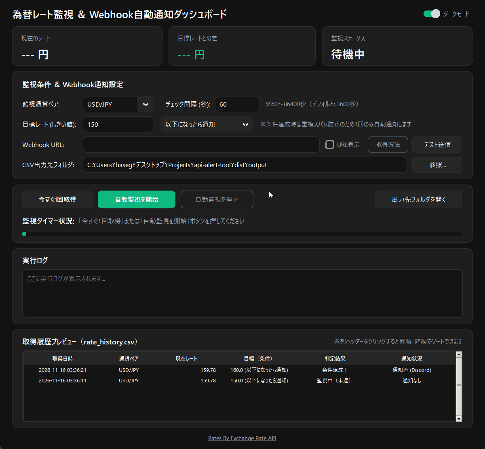

# 為替レート監視 ＆ Webhook自動通知ダッシュボード（api-alert-tool）

**無料公開APIによる日次レート自動監視（高頻度・有償APIへの差し替えも容易なモジュール設計）** を備え、設定した目標レート（しきい値）の条件を満たした際に **Discord** または **Slack** へ自動通知する Windows 向けデスクトップアプリケーションです。

---

## 1. 解決する課題・導入メリット

海外仕入れ・外貨建て決済・越境ECなどを扱う業務において、以下のような課題を自動化によって解決します。

- **毎日の手動レート確認・記録作業をゼロに**
  - ブラウザで為替サイトを開いて確認・転記する手間を省き、指定間隔（60秒〜86400秒、デフォルト：3600秒）で為替レート（`USD/JPY`、`EUR/JPY`、`GBP/JPY`、`AUD/JPY`）を自動巡回します。
- **目標レート到達を見逃さずチャットへ即時通知**
  - 「150.00円以下になったら通知」などの条件を設定しておくだけで、普段業務で使っている **Discord** や **Slack** に自動でアラートが届きます。
  - 一度通知した後は通常圏に戻るまで再通知を抑止する**重複通知（スパム）防止機能**を搭載しています。
- **Excelでそのまま開ける履歴CSVを自動蓄積（ファイルロック退避対応）**
  - チェック結果は自動で `rate_history.csv`（BOM付きUTF-8）に追記保存されます。万が一 Excel でファイルを開いたままにしていても、エラーでデータを失わず `rate_history_backup_YYYYMMDD_HHMMSS.csv` へ自動退避保存します。
- **Python環境不要・APIキー登録不要ですぐに導入可能**
  - 単体実行ファイル（`為替レート監視自動通知ツール.exe`）をダブルクリックするだけで、非エンジニアの方のPCでもすぐに稼働します。

---

## 2. 動作デモ



---

## 3. 3ステップの使い方

Pythonのインストールは不要です。同梱の `為替レート監視自動通知ツール.exe` を起動し、以下の3ステップですぐに利用開始できます。

### ステップ1：監視条件を設定する
- **監視通貨ペア**（`USD/JPY` / `EUR/JPY` / `GBP/JPY` / `AUD/JPY`）、**目標レート**（例: `150.00`）、**判定条件**（`以下になったら通知` / `以上になったら通知`）、**チェック間隔**（`60`〜`86400`秒、デフォルト：`3600`秒）を入力します。

### ステップ2：通知先 Webhook URL を設定する（任意）
- Discord または Slack の Webhook URL を貼り付け、**「テスト送信」** ボタンで通知が届くか確認します。
- URLの発行手順が分からない場合は、入力欄横の **「取得方法」** ボタンを押すと画面上で3ステップの手順を確認できます（※空欄のままでも画面監視・CSV記録ツールとして利用可能です）。

### ステップ3：「自動監視を開始」または「今すぐ1回取得」を押す
- **「今すぐ1回取得」** で単発チェック、**「自動監視を開始」** でバックグラウンド定期監視を開始します。
- 取得履歴は画面下部のテーブルに一覧表示され、**「出力先フォルダを開く」** ボタンからいつでもCSVファイルを確認できます。

---

## 4. 実務での応用例（「業務自動化の型」としての活用）

本ツールは **「① 外部データ取得（`api_client.py`） → ② 条件判定・重複制御 → ③ チャット通知（Discord / Slack） ＆ CSV記録 → ④ GUIダッシュボード表示（`gui.py`）」** という業務自動化の標準テンプレートとして疎結合に設計されています。

通信モジュール（`api_client.py`）の取得先を差し替えるだけで、以下のような幅広い業務監視ツールへ短期間でカスタマイズ・横展開が可能です。

1. **高頻度・商用の為替／金融APIへの差し替え**
   - デフォルトではAPIキー不要の無料公開APIによる日次レート自動監視を行っていますが、企業向けの有償リアルタイム為替APIや社内基幹APIへも、UI側を変更せず通信関数のみの差し替えで対応可能です。
2. **ECサイト・競合商品の在庫／価格変動アラート**
   - 仕入れ先や競合サイトの価格・在庫APIを定期巡回し、「在庫が復活した瞬間」「指定価格を下回った瞬間」に Slack / Discord へ自動通知し、価格推移をCSVに蓄積するツールへ応用できます。
3. **Webサイト更新検知・システム死活監視（ヘルスチェック）**
   - 自社サーバーのAPI応答監視や官公庁・取引先の公開データ更新を定期チェックし、異常検知時や新着情報検出時に担当者チャットへ即時アラートを飛ばす運用監視ダッシュボードとして活用できます。

---

## 5. 技術スタック・ディレクトリ構成

### 技術スタック

| カテゴリ | 使用技術 / ライブラリ | 用途 |
| :--- | :--- | :--- |
| **言語** | Python 3.x | アプリケーション全体の実装（バックエンド通信とGUIの完全分離設計） |
| **HTTP通信** | `requests` | 為替レートAPI取得（HTTP 429検知・リトライ制御）、Webhook POST送信 |
| **データ処理** | `pandas` | 取得履歴データの構造化、CSV読み書き（`utf-8-sig`・ロック時退避処理） |
| **GUIフレームワーク** | `customtkinter` / `tkinter.ttk` | ダーク／ライト切替対応モダンUI、KPIカード、Treeviewテーブル |
| **パッケージング** | `PyInstaller` | Python環境不要で動作するWindows向け単体実行ファイル（`.exe`）のビルド |

### セキュリティ・安全性設計
- **スレッドセーフ設計**: サブスレッドから Tkinter の変数を直接参照せず、メインスレッドで検証した設定スナップショットを受け渡し、`threading.Lock` により単発取得と定期監視の競合・重複通知を排他制御しています。
- **秘密トークンの漏洩防止**: 通信エラー時などの例外メッセージやログ出力に含まれる URL（Webhook トークン等）は正規表現により自動で `[MASKED_URL]` にマスク処理されます。
- **API利用規約・レート制限への準拠**: HTTP `429`（レート制限）検知時は無駄なリトライを即時停止して待機案内を表示し、画面最下部に ExchangeRate-API の規約に基づく出典リンク（[Rates By Exchange Rate API](https://www.exchangerate-api.com)）を配置しています。

### ディレクトリ構成

```text
api-alert-tool/
├── api_client.py      # バックエンドモジュール（API通信・HTTP 429処理・条件判定・Webhook送信・CSV退避保存）
├── gui.py             # フロントエンドモジュール（CustomTkinter製GUI・スレッドセーフ監視制御・ヘルプダイアログ）
├── SPEC.md            # 設計仕様書
├── README.md          # プロジェクト説明書（本ファイル）
├── requirements.txt   # 依存パッケージ一覧
├── .gitignore         # Git除外設定（.venv, config.json, output/, 納品物_*/ 等）
├── config.json        # ユーザー設定の永続化ファイル（.gitignore 対象）
└── output/            # 取得履歴CSVの出力先ディレクトリ（デフォルト、.gitignore 対象）
    └── rate_history.csv
```

### 開発環境での実行・ビルド手順

```powershell
# 仮想環境の有効化と依存パッケージのインストール
python -m venv .venv
.\.venv\Scripts\Activate.ps1
pip install -r requirements.txt

# ソースコードからの起動
python gui.py

# 単体実行ファイル（為替レート監視自動通知ツール.exe）のビルド
.\.venv\Scripts\pyinstaller.exe --noconfirm --onefile --windowed --collect-all customtkinter --name "為替レート監視自動通知ツール" gui.py
```

---

## ライセンス・免責事項

- [Rates By Exchange Rate API](https://www.exchangerate-api.com)（為替レートデータは ExchangeRate-API Open Access より取得しています）
- 本ツールの取得レートは参考値であり、実際の金融取引・投資判断における正確性やリアルタイム性を保証するものではありません。
